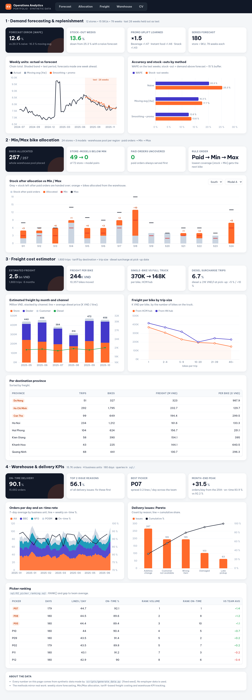
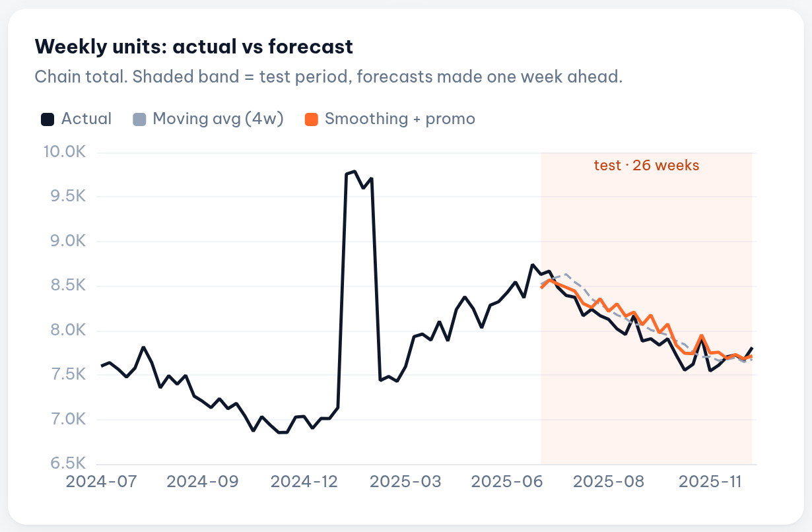
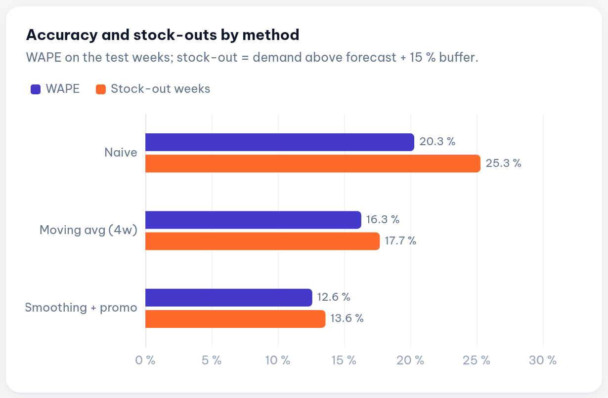
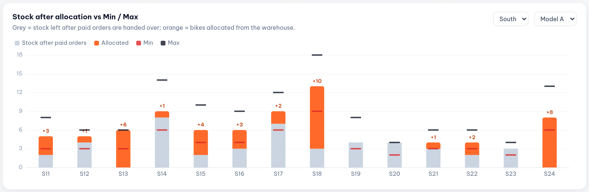
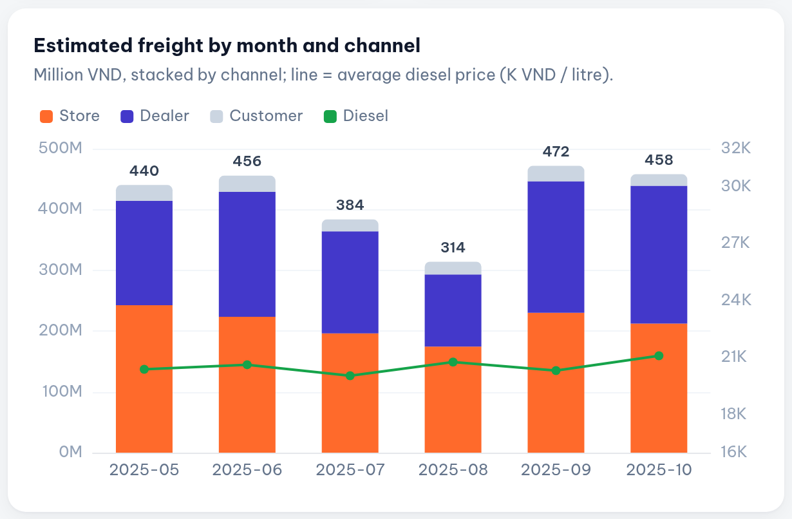
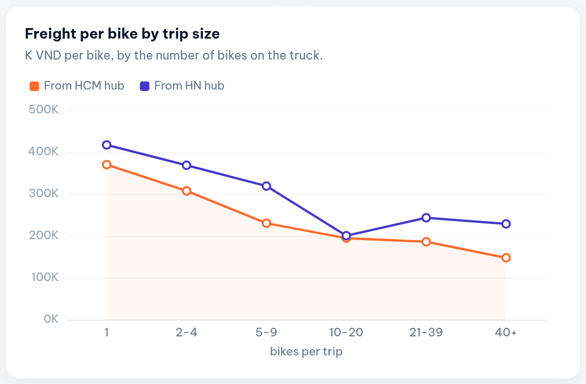
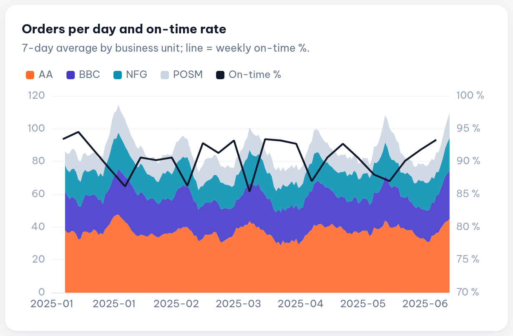
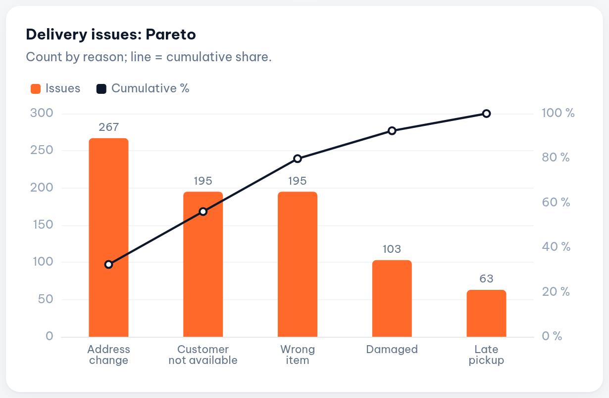

# Operations Analytics Portfolio · Huynh Khang Vinh

Business Operations Analyst working across supply chain, warehousing and logistics. This repo collects four small,
end-to-end projects that mirror the work I do every day: forecasting store demand, allocating stock, costing freight
and tracking warehouse KPIs. Each one starts from raw CSVs, runs in Python and SQL, and ends on an interactive dashboard.

> **All data in this repo is synthetic.** It is generated by [`scripts/generate_data.py`](scripts/generate_data.py) with a
> fixed seed. No employer or customer data is used. The methods are real; the numbers are not.

| | |
|---|---|
| **CV** | [Web, clickable](https://dinndinn1204.github.io/Khang-Vinh_Portfolio/cv.html) · [PDF](docs/CV_Huynh_Khang_Vinh.pdf) |
| **Dashboard** | [https://dinndinn1204.github.io/Khang-Vinh_Portfolio/](https://dinndinn1204.github.io/Khang-Vinh_Portfolio/) (source: [`docs/index.html`](docs/index.html)) |
| **Contact** | khangvinh.career@gmail.com |



---

## Projects

### 1 · Demand forecasting & replenishment

Weekly sales for 12 stores × 15 SKUs over 78 weeks (180 series), with seasonality, a Tết peak and planned promotions.
The last 26 weeks are held out and forecast one week ahead with three methods:

| Method | WAPE | Stock-out weeks* |
|---|---:|---:|
| Naive (last week) | 20.3 % | 25.3 % |
| Moving average (4 weeks) | 16.3 % | 17.7 % |
| **Exponential smoothing + promo uplift** | **12.6 %** | **13.6 %** |

\* share of store × SKU weeks where demand was above the order-up-to level (forecast + 15 % buffer).

The promo uplift (×1.43 to ×1.47 by category) is learned on the training weeks only, so the test stays honest.




### 2 · Min/Max bike allocation

24 stores × 3 models share one warehouse pool per region. [`scripts/allocation.py`](scripts/allocation.py) places the pool
one bike at a time:

1. **Paid orders first:** a store whose paid orders exceed its stock is covered before anything else.
2. **Fill to Min:** the store with the lowest coverage (stock ÷ Min) gets the next bike.
3. **Spread to Max:** whatever is left goes out the same way, never above Max.

Result on the sample: all 257 bikes placed, store-models below Min go from **49 to 0**, and no paid order is left uncovered.
The module carries its own assert-based self-check (`python scripts/allocation.py`).



### 3 · Freight cost estimator

1,800 trips over six months from two hubs (HCM, Hà Nội) to 20 provinces. Each trip is priced from a
destination × trip-size tariff (1, 2-4, 5-9, 10-20, 21-39, 40+ bikes), then adjusted by the diesel price in the week of
pick-up (below 21K VND/l: base, below 23K: +5 %, otherwise +10 %). The monthly roll-up by channel is plain SQL
([`sql/04_freight_by_month_channel.sql`](sql/04_freight_by_month_channel.sql)).

- Estimated freight: **2.52 bn VND** for 10,357 bikes, about **244K VND per bike**.
- From the HCM hub, a full truck costs well under half as much per bike as a single-bike trip.
- 6.7 % of trips carried a diesel surcharge.




### 4 · Warehouse & delivery KPIs (SQL)

15,682 orders across four business units over 180 days, analysed with SQLite queries in [`sql/`](sql):

| Query | What it shows | Techniques |
|---|---|---|
| [`01_ontime_by_bu_month.sql`](sql/01_ontime_by_bu_month.sql) | on-time rate and lead time per business unit and month | CTE, conditional aggregation |
| [`02_picker_ranking.sql`](sql/02_picker_ranking.sql) | lines per day, on-time share, rank and gap to team average | CTEs, `RANK()`, `AVG() OVER ()` |
| [`03_issue_pareto.sql`](sql/03_issue_pareto.sql) | issues by reason with cumulative share | running `SUM() OVER (ORDER BY …)` |

- On-time delivery **90.1 %** overall; orders per day rise **31.5 %** from the 25th of each month and on-time drops from 92.2 % to 83.9 %.
- The top two issue reasons account for **56.1 %** of all issues, so they are where to start.




---

## How to run

Requirements: Python 3.10+, and for the PNG export Node 18+ with Google Chrome.

```bash
pip install -r requirements.txt
python scripts/generate_data.py   # data/*.csv (fixed seed, same output every run)
python scripts/analyze.py         # output/*.csv, output/summary.json, docs/data.js
node scripts/shoot.mjs            # docs/charts/*.png and docs/preview.png from the dashboard
```

Open `docs/index.html` in a browser to explore the dashboard (region / model filter on the allocation chart, tooltips everywhere).
To rebuild the CV PDF:

```bash
google-chrome --headless=new --no-pdf-header-footer --print-to-pdf=docs/CV_Huynh_Khang_Vinh.pdf docs/cv.html
```

To publish the dashboard: **Settings → Pages → Deploy from a branch → `main` / `docs`**.

## Repository layout

```
├── data/                synthetic input CSVs (generated)
├── docs/                published with GitHub Pages
│   ├── index.html       dashboard (+ data.js, preview.png)
│   ├── cv.html          clickable CV, CV_Huynh_Khang_Vinh.pdf
│   └── charts/          PNG charts exported from the dashboard
├── output/              result tables and summary.json
├── scripts/
│   ├── generate_data.py synthetic data for all four projects
│   ├── allocation.py    Min/Max allocation engine + self-check
│   ├── analyze.py       forecasting, allocation, freight pricing, SQL KPIs
│   └── shoot.mjs        headless-Chrome export of the chart cards
└── sql/                 SQLite queries for freight and warehouse KPIs
```

## Tech stack

Python (pandas, NumPy) · SQL (SQLite here; MySQL, BigQuery and T-SQL at work) · Apache ECharts · HTML/CSS · Node + Chrome DevTools Protocol for the export.
At work I also use Power BI, Google Apps Script, AppSheet, Streamlit, SAP Business One and Smartlog WMS.

## License

Code under the [MIT License](LICENSE). The synthetic data may be reused freely.
